# Phase 1 — IDSS Database and Master Data

## Scope and source

This implementation is based on the IDSS SRS supplied to the project, particularly:

- Functional requirements FR-013–FR-020 (user, organization and office assignment).
- FR-021–FR-030 (farm registration and farm master data).
- FR-031–FR-040 (farmer profiles, search, status and ownership history).
- FR-041–FR-055 (individual animal identity and traceability history).
- FR-199–FR-202 (master reference data, administrative boundaries, laboratory information and disease classifications).
- SRS Chapter 6, Database Requirements, especially sections 6.3–6.22.

The change is additive. Existing tables and data are preserved; no `migrate:fresh`, destructive table replacement, or production data seeding is part of this change.

## Delivered

### 1. Normalized database structures

The new migration adds or extends the following SRS entity groups:

| Entity group | Tables / structures |
|---|---|
| Organizations and authorization | organizations, departments, offices, roles, permissions, role_user, permission_role |
| Administrative geography | administrative_areas (self-referencing hierarchy) |
| Farmer registry | farmers (extended), farmer_contacts, farmer_addresses, farmer_ownership_history |
| Farm registry | farms (extended), farm_types, farm_locations, farmer_farm |
| Animal registry and identification | animals (extended), species, breeds, animal_identifications |
| Animal traceability and health | animal_movements, animal_ownership_transfers, vaccination_campaigns, vaccinations, disease_categories, disease_symptoms, animal_disease_records |
| Disease surveillance relationships | disease_cases (extended with optional animal/category/area links), disease_case_symptom, outbreak_case |
| Laboratory registry | laboratories (existing), laboratory_sections, laboratory_user, laboratory_equipment |
| Laboratory test catalogue and workflow data | laboratory_tests, test_methods, laboratory_test_assignments, laboratory_test_results (extended) |
| Sample management | sample_types, sample_transportations, sample_storage_records, sample_movements (existing chain-of-custody history) |
| Quality control | quality_control_records |
| Reporting and administration | report_definitions, generated_reports, dashboard_definitions, system_settings |
| Existing operational records | samples, investigations, notifications, audit_logs and outbreaks retained |

Primary keys are database-generated. Foreign keys and unique constraints protect the relationships and business identifiers. Frequently filtered or searched attributes receive indexes. Existing farmer/farm/animal and surveillance records remain in place.

### 2. Farmer and farm data

- Farmer, farm and animal registries support profile editing and non-destructive archival; archived records retain linked case, animal, ownership, health and movement history.
- Farmer registration and self-registration write normalized contact and address records; address history is retained when a primary physical address changes.
- Farm updates retain successive owner periods and farm location history; animal transfers between farms and replacement identifiers are recorded as separate traceability events.
- Staff accounts can be assigned to an organization, department, office/duty station and mobile number; the server validates that the selected department and office belong to the selected organization.
- Canonical staff roles are synchronized to the normalized role assignment pivot when staff accounts are created or changed.
- Farmer profile now has sex, date of birth, nationality, farmer type, status and archive timestamp fields.
- Farmer contacts and addresses are normalized into child tables.
- Farm records support farm type, farm size, administrative-area linkage and archive status.
- The farmer–farm pivot supports multiple joint owners and effective-date ownership history while retaining the existing `farms.farmer_id` compatibility field.
- Farm location history is represented separately from the current farm record.

### 3. Animal data

- Animal records can link to both a registered farm and farmer.
- Species and breed catalogues are normalized.
- Multiple identifiers per animal support RFID, ear tag, microchip, tattoo and QR identifier records, including replacement/retirement status.
- Separate tables hold movement, ownership transfer, vaccination and animal disease history.
- Disease cases can optionally reference an individual animal, disease category and administrative area. The animal reference is nullable to preserve existing farm-level reports.

### 4. Master data administration

A System Administrator-only Master Data page is available from the sidebar. It supports create, list/search, edit and archive for:

- Organizations, departments and offices, with organization/department hierarchy validation
- Farm types
- Species and breeds
- Disease categories and symptoms
- Sample types
- Laboratory tests and test methods
- Administrative areas

Changes are written to the existing audit log. Master data uses inactive/archive states rather than physical deletion where the model supports soft deletion.

### 5. Seeded data

The seeders create the eight canonical IDSS roles already defined in `config/idss.php`, and map existing accounts with matching canonical or legacy administrator role labels into the normalized `role_user` pivot without changing their existing `users.role` value.

The Farm Type catalogue is seeded only with classifications explicitly listed in SRS FR-026: Pastoral, Agro-pastoral, Commercial, Dairy, Ranch and Poultry.

No species, breeds, disease list, symptoms, sample types, test methods, laboratories, organizations, departments, offices or administrative boundary names are invented or preloaded. Those catalogues remain available for authorized administration once approved Ministry reference data is supplied.

## Entity relationship diagram

The diagram shows the principal relationships introduced or extended in Phase 1. Some existing workflow entities are shown for context.

```mermaid
erDiagram
    ORGANIZATIONS ||--o{ DEPARTMENTS : contains
    ORGANIZATIONS ||--o{ OFFICES : contains
    DEPARTMENTS ||--o{ OFFICES : contains
    ADMINISTRATIVE_AREAS ||--o{ ADMINISTRATIVE_AREAS : parent_of
    ADMINISTRATIVE_AREAS ||--o{ OFFICES : locates
    ORGANIZATIONS ||--o{ USERS : assigns
    DEPARTMENTS ||--o{ USERS : assigns
    OFFICES ||--o{ USERS : assigns
    USERS ||--o{ ROLE_USER : has
    ROLES ||--o{ ROLE_USER : assigned
    ROLES ||--o{ PERMISSION_ROLE : grants
    PERMISSIONS ||--o{ PERMISSION_ROLE : included

    FARMERS ||--o{ FARMER_CONTACTS : has
    FARMERS ||--o{ FARMER_ADDRESSES : has
    FARMERS ||--o{ FARMER_OWNERSHIP_HISTORY : history
    FARMERS ||--o{ FARMER_FARM : owns
    FARMS ||--o{ FARMER_FARM : ownership
    FARM_TYPES ||--o{ FARMS : classifies
    ADMINISTRATIVE_AREAS ||--o{ FARMS : locates
    FARMS ||--o{ FARM_LOCATIONS : locations

    FARMS ||--o{ ANIMALS : keeps
    FARMERS ||--o{ ANIMALS : owns
    SPECIES ||--o{ BREEDS : has
    SPECIES ||--o{ ANIMALS : classifies
    BREEDS ||--o{ ANIMALS : classifies
    ANIMALS ||--o{ ANIMAL_IDENTIFICATIONS : identified_by
    ANIMALS ||--o{ ANIMAL_MOVEMENTS : moves
    ANIMALS ||--o{ ANIMAL_OWNERSHIP_TRANSFERS : transfers
    ANIMALS ||--o{ VACCINATIONS : receives
    VACCINATION_CAMPAIGNS ||--o{ VACCINATIONS : includes
    ANIMALS ||--o{ ANIMAL_DISEASE_RECORDS : health_history
    DISEASE_CATEGORIES ||--o{ ANIMAL_DISEASE_RECORDS : classifies

    ANIMALS o|--o{ DISEASE_CASES : affected_in
    DISEASE_CATEGORIES o|--o{ DISEASE_CASES : classifies
    DISEASE_CASES ||--o{ INVESTIGATIONS : investigated
    DISEASE_CASES ||--o{ SAMPLES : sampled
    OUTBREAKS ||--o{ OUTBREAK_CASE : groups
    DISEASE_CASES ||--o{ OUTBREAK_CASE : included

    LABORATORIES ||--o{ LABORATORY_SECTIONS : has
    LABORATORIES ||--o{ LABORATORY_USER : staffs
    USERS ||--o{ LABORATORY_USER : assigned
    LABORATORIES ||--o{ LABORATORY_TEST_ASSIGNMENTS : receives
    SAMPLES ||--o{ LABORATORY_TEST_ASSIGNMENTS : tested
    LABORATORY_TESTS ||--o{ LABORATORY_TEST_ASSIGNMENTS : assigned
    LABORATORY_TESTS ||--o{ LABORATORY_TEST_RESULTS : produces
    TEST_METHODS ||--o{ LABORATORY_TEST_RESULTS : method
    LABORATORIES ||--o{ QUALITY_CONTROL_RECORDS : controls
    LABORATORY_EQUIPMENT }o--|| LABORATORIES : belongs_to

    SAMPLES ||--o{ SAMPLE_MOVEMENTS : tracked
    SAMPLES ||--o{ SAMPLE_TRANSPORTATIONS : transported
    SAMPLES ||--o{ SAMPLE_STORAGE_RECORDS : stored
    SAMPLE_TYPES ||--o{ SAMPLES : classifies
    USERS ||--o{ AUDIT_LOGS : performs
```

## Validation and test coverage

Automated feature tests added for:

- Organization, department and office administration, including cross-organization assignment rejection.
- Staff organization/duty-station assignment and normalized role linkage.
- Farmer contact/address normalization, profile editing and archival.
- Farm ownership/location history during updates.
- Animal farm movement and identification replacement history.
- Presence of the SRS major database entities and key farmer/farm/animal extensions.
- Repeatable role and farm-type seeding.
- Multiple farmers linked to a single farm.
- Administrator-only master data access.
- Creation of master data and corresponding audit record.

The repository CI uses SQLite for automated feature tests. Production database target remains PostgreSQL 14+; production PostgreSQL/PostGIS deployment validation is not claimed by this phase.

## Ministry inputs still required before loading live reference data

1. Authoritative administrative boundary dataset, official codes, hierarchy and coordinate reference system.
2. Approved species and breed catalogue.
3. Approved disease classifications and symptom catalogue.
4. Approved sample type, diagnostic test and test method catalogues.
5. Official organizations, departments, offices and laboratory registry.
6. National rules for farmer and farm identifiers, including whether existing generated identifiers must be retained or migrated.
7. Government retention, archival and record-disposal schedule.

These are data governance inputs, not values to be guessed by the development team.

## Phase 1 exit status

**Phase 1 software foundation and registry workflows implemented in code and automated tests.** Ministry reference-data loading and final production sign-off remain conditional on running migrations against the Ministry PostgreSQL/PostGIS environment, loading approved reference datasets, and reconciling existing records. The phase does not claim that the whole IDSS is production-ready.
